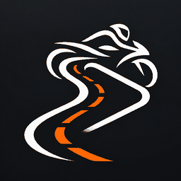

# RidePlay

*A personalized CarPlay experience for motorcycles.*

[简体中文](README.md) · **English** · [繁體中文](README.zh-TW.md)



RidePlay is a personal fork of [DiPlay](https://github.com/shihabal3amri/DiPlay), installed on an Android receiver and used with an iPhone. **KTM MY RIDE** is the first integration target; the project name is not tied to one motorcycle brand.

[Download](https://github.com/Chiccccken/RidePlay/releases) · [简体中文入门指南](docs/RIDEPLAY_QUICKSTART.zh-CN.md) · [0.3.1 release notes](docs/RELEASE-NOTES-0.3.1.md) · [Build from source](docs/BUILD.md)

## Why I forked DiPlay

My riding setup uses an Android receiver for CarPlay navigation and its interface, with music sent directly from the iPhone to a Bluetooth helmet headset. I also want to keep the KTM's original handlebar play, pause and track controls.

DiPlay already provides the wired/wireless CarPlay receiver that makes this possible. In my setup, however, Android media sessions and Bluetooth media-key routing needed additional adaptation when music was not playing through Android. Song information on the instrument also needed a more readable presentation. I forked DiPlay to add media controls, metadata conversion and everyday preferences for this use case.

## Changes from DiPlay

- **Audio-free media controls (experimental):** publish song information and the actual playback state to Android while CarPlay audio reception is disabled, and forward play/pause/previous/next to the iPhone. This supports keeping music output on the iPhone/headset.
- **Media-key routing bootstrap (experimental):** an optional helper for systems that need it, triggered after iPhone media information arrives or when returning to CarPlay. It is off by default and takes effect after reconnecting. Enabling it may take media-key ownership from another Android player.
- **Pinyin and artist-name replacements:** optional offline conversion of song, artist and album names, plus exact full-name artist replacements. Only Android media-session metadata is transformed; the CarPlay picture keeps the original text. Pinyin requires Android 10 or later and is off by default.
- **Orientation preferences:** saved orientation choices for home, settings and CarPlay, with startup rotation mitigation.
- **Separate app and updates:** RidePlay branding, package identity and release signing. In-app updates use this repository and validate download origins and checksums. RidePlay can coexist with upstream DiPlay.
- **Settings backup and diagnostics:** backups include media-control, pinyin, artist-name and orientation choices. Diagnostics add bounded command summaries and unacknowledged-packet attribution while filtering protocol payloads and sensitive fields. Native diagnostic paths are project-relative.

The wired/wireless CarPlay receiver and existing head-unit integrations come from upstream. BYD-specific features retain their original scope.

## Current field testing

The current public version is **0.3.1, a public preview**. I have used it over several days on a **2019 KTM 390 Duke** and confirmed:

- Connection after installation, reconnecting within the app, and opening the app to connect after restarting the Android receiver.
- Handlebar play/pause/previous/next in the vehicle.
- Normal music output from the iPhone to the helmet headset.

These are real-use reports. Other vehicles and Android firmware need their own testing. Siri, call audio, complete background/lock-screen recovery and startup orientation have not completed dedicated acceptance testing. Use the [release notes](docs/RELEASE-NOTES-0.3.1.md) for the current scope; earlier design and experiment documents preserve their historical observations.

## Install and build

Install on the **Android receiver**, with Android 7.0+ (API 24). Release builds use `com.chiccccken.rideplay`; debug builds use `com.chiccccken.rideplay.debug`. Their data is separate. Run only one CarPlay receiver app at a time when testing.

Download the APK from [RidePlay Releases](https://github.com/Chiccccken/RidePlay/releases) and verify it against `SHA256SUMS.txt` on the same page. Updates signed with the same release key can retain data. Back up settings before migrating from a debug build.

Ordinary source/CI builds omit runtime accessory authentication assets needed for standalone connection. The public standalone APK includes the upstream experimental accessory identity. Read the [build instructions](docs/BUILD.md) and [third-party notices](docs/THIRD_PARTY_NOTICES.md) before preparing your own device-test package.

```sh
./gradlew :mobile:assembleDebug
```

See [AGENTS.md](AGENTS.md) for the complete unit-test, lint and build command.

## Repository and documentation

[`custom`](https://github.com/Chiccccken/RidePlay/tree/custom) is the development and default display branch; `main` is used for the upstream mirror. See the [maintenance design](docs/KTM_UPSTREAM_SYNC.md) for upstream synchronization plans.

[Install and connect](docs/INSTALL.md) · [Compatibility](docs/COMPATIBILITY.md) · [Privacy](docs/PRIVACY.md) · [Release checks](docs/RIDEPLAY_RELEASE_CHECKLIST.md)

Some installation, compatibility and privacy documents retain upstream context. Diagnostics still use `Downloads/DiPlay`. Review reports and remove personal information before sharing them publicly.

## Source and credits

Thanks to [DiPlay](https://github.com/shihabal3amri/DiPlay) and [xcertplay](https://github.com/shilapi/xcertplay) for the foundation; this project follows GPL-3.0. Upstream's interface and website adapt [DiAuto](https://github.com/shihabal3amri/DiAuto), AGPL-3.0. Original [license and third-party notices](docs/THIRD_PARTY_NOTICES.md) are retained. RidePlay is independent and is not affiliated with Apple, KTM or BYD.
