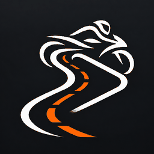

# RidePlay

*A personalized CarPlay experience for motorcycles.*

[简体中文](README.zh-CN.md) · [繁體中文](README.zh-TW.md)



RidePlay is a personal fork of [DiPlay](https://github.com/shihabal3amri/DiPlay), adapted for a motorcycle setup with an Android receiver and an iPhone. **KTM MY RIDE is the first integration target; motorcycle compatibility has not yet been verified on a physical bike.**

## What's different

- A separate RidePlay app identity and the selected motorcycle/road icon.
- Optional control-only Android media sessions while CarPlay audio reception is disabled. This is experimental; the iPhone's audio route must be verified separately.
- Optional offline pinyin for song, artist and album metadata, plus exact artist-name replacements. The CarPlay picture retains the original text.
- A saved rotation preference for the home, settings and CarPlay screens; startup rotation mitigation is awaiting device confirmation.

The wired/wireless receiver and the existing head-unit integrations come from upstream. BYD-specific features do not establish KTM compatibility.

## Current validation

The user has reported successful iPhone connection, Android media-card display, play/pause/previous/next controls and metadata restoration after reconnecting. These are device reports, not a complete compatibility certification. KTM instrument display and handlebar controls, helmet audio routing, background/lock-screen recovery and startup rotation still need end-to-end tests. See [media-session validation](docs/RIDEPLAY_P1.md), [pinyin](docs/RIDEPLAY_PINYIN.md) and [rotation](docs/RIDEPLAY_ORIENTATION.md).

## Install and build

Install RidePlay on the **Android receiver**, not the iPhone. Android 7.0+ (API 24) is required. The personal release package is `com.chiccccken.rideplay`; debug builds use `com.chiccccken.rideplay.debug` and can coexist with upstream DiPlay.

[RidePlay releases](https://github.com/Chiccccken/RidePlay/releases) are separate from upstream releases. Do not treat an upstream DiPlay APK as a RidePlay update. Ordinary source/CI builds omit runtime accessory authentication assets; they are not standalone connection packages. Read [Build from source](docs/BUILD.md) before preparing a device-test build.

```sh
./gradlew :mobile:assembleDebug
```

Follow [AGENTS.md](AGENTS.md) for the complete unit-test, lint and build command. A successful APK build alone does not establish that the full checks or physical-device tests passed.

## Repository and maintenance

- [`custom`](https://github.com/Chiccccken/RidePlay/tree/custom) is the RidePlay development branch and the intended repository homepage.
- `main` is the upstream mirror. Do not add RidePlay branding commits to it.
- Automatic upstream synchronization has not been deployed. Follow the [synchronization design](docs/KTM_UPSTREAM_SYNC.md) before enabling it.
- The inherited app updater still queries upstream DiPlay. A RidePlay release channel, version policy and stable signing must be completed before distributing app updates.
- The inherited website deploy job is restricted to the upstream repository; this fork does not claim to host the upstream download site.

[Implementation plan](docs/KTM_CUSTOM_PLAN.md) · [Release checklist](docs/RIDEPLAY_RELEASE_CHECKLIST.md) · [Install and connect](docs/INSTALL.md) · [Compatibility](docs/COMPATIBILITY.md) · [Privacy](docs/PRIVACY.md)

The installation, compatibility and privacy guides retain upstream context. Diagnostics currently use `Downloads/DiPlay`; the path is intentionally unchanged so existing reports and instructions stay accurate.

## Source and credits

RidePlay is based on DiPlay and [xcertplay](https://github.com/shilapi/xcertplay), GPL-3.0. Upstream's interface and website adapt [DiAuto](https://github.com/shihabal3amri/DiAuto), AGPL-3.0. Preserve the [license and third-party notices](docs/THIRD_PARTY_NOTICES.md). RidePlay is independent and is not affiliated with Apple, KTM or BYD.
