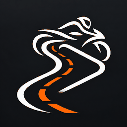

# RidePlay

*面向摩托车的个性化 CarPlay 体验。*

[English](README.md) · [繁體中文](README.zh-TW.md)



RidePlay 是基于 [DiPlay](https://github.com/shihabal3amri/DiPlay) 的个人定制项目，配合 Android 接收端与 iPhone 使用。**首个适配目标是 KTM MY RIDE，目前尚未完成 KTM 实车兼容性验证。**项目名称不限定摩托车品牌。

## 相比上游的改动

- 独立的 RidePlay 应用名称和包名，使用已选定的摩托车／道路图标。
- 可选的无音频媒体控制：关闭 CarPlay 音频接收时，仍向 Android 发布媒体会话。此功能为实验性，iPhone 的实际音频路由需另行验证。
- 歌名、歌手和专辑名的离线拼音，以及完整歌手名称的自定义替换；CarPlay 画面保留原文。
- 首页、设置和 CarPlay 的方向偏好；启动方向闪屏的缓解改动仍待真机确认。

有线／无线 CarPlay 接收能力及现有车机集成来自上游。比亚迪专属功能不代表已适配 KTM。

## 已验证到哪里

用户已反馈：连接 iPhone、Android 媒体卡片、播放／暂停／上一首／下一首，以及重连后的元数据恢复正常。这些属于设备反馈，尚不构成完整兼容性验收。

仍需验证 KTM 仪表显示与车把按键、头盔音频路由、后台／锁屏恢复，以及启动方向闪屏。详见[媒体控制验证](docs/RIDEPLAY_P1.md)、[拼音说明](docs/RIDEPLAY_PINYIN.md)和[方向说明](docs/RIDEPLAY_ORIENTATION.md)。

## 安装与构建

安装在 **Android 接收端**，不是 iPhone。最低支持 Android 7.0（API 24）。个人正式包名为 `com.chiccccken.rideplay`；debug 包名为 `com.chiccccken.rideplay.debug`，可与上游 DiPlay 共存。

[RidePlay 发布页](https://github.com/Chiccccken/RidePlay/releases)与上游发布页相互独立，不要将上游 APK 当成 RidePlay 更新。普通源码／CI 构建不含运行时配件认证材料，不能当作可独立连接的完整测试包。准备真机测试包前请阅读[构建说明](docs/BUILD.md)。

```sh
./gradlew :mobile:assembleDebug
```

完整单元测试、Lint 和构建命令见 [AGENTS.md](AGENTS.md)。仅生成 APK 不代表全套检查或实车测试通过。

## 仓库与维护

- [`custom`](https://github.com/Chiccccken/RidePlay/tree/custom) 是 RidePlay 开发分支，也是预期的仓库首页分支。
- `main` 保持上游镜像，不向其中加入 RidePlay 品牌提交。
- 上游自动同步尚未部署，启用前按[同步设计](docs/KTM_UPSTREAM_SYNC.md)完成实现和演练。
- 应用继承的更新检查仍查询上游 DiPlay；正式分发前需要独立的更新源、版本规则和固定签名。
- 上游网站部署任务已限制为仅在上游仓库运行；此 fork 不宣称提供上游下载网站。

[实施计划](docs/KTM_CUSTOM_PLAN.md) · [发布前清单](docs/RIDEPLAY_RELEASE_CHECKLIST.md) · [安装与连接](docs/INSTALL.md) · [兼容性](docs/COMPATIBILITY.md) · [隐私](docs/PRIVACY.md)

安装、兼容性和隐私文档仍保留上游背景；诊断报告目录继续使用 `Downloads/DiPlay`，避免现有报告位置与说明不一致。

## 来源与致谢

RidePlay 基于 DiPlay 和 [xcertplay](https://github.com/shilapi/xcertplay)（GPL-3.0）。上游界面和网站参考 [DiAuto](https://github.com/shihabal3amri/DiAuto)（AGPL-3.0），保留[许可证及第三方声明](docs/THIRD_PARTY_NOTICES.md)。本项目独立开发，与 Apple、KTM、比亚迪无隶属或背书关系。
