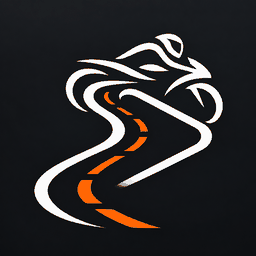

# RidePlay

*為摩托車提供個人化 CarPlay 體驗。*

[English](README.md) · [简体中文](README.zh-CN.md)



RidePlay 是基於 [DiPlay](https://github.com/shihabal3amri/DiPlay) 的個人客製專案，搭配 Android 接收端與 iPhone 使用。**首個適配目標為 KTM MY RIDE，目前尚未完成 KTM 實車相容性驗證。**名稱不限定摩托車品牌。

## 相較上游的變更

- 獨立的 RidePlay 應用程式名稱與套件名稱，使用已選定的摩托車／道路圖示。
- 可選的無音訊媒體控制：停用 CarPlay 音訊接收時，仍向 Android 發布媒體工作階段。這是實驗性功能，iPhone 實際的音訊路由需另行驗證。
- 歌名、歌手及專輯名稱的離線拼音，以及完整歌手名稱的自訂替換；CarPlay 畫面保留原文。
- 首頁、設定及 CarPlay 的方向偏好；啟動方向閃爍的緩解變更仍待真機確認。

有線／無線 CarPlay 接收能力與現有車機整合來自上游。比亞迪專屬功能不代表已適配 KTM。

## 驗證狀態

使用者已回報：連線 iPhone、Android 媒體卡片、播放／暫停／上一首／下一首，以及重新連線後的中繼資料恢復正常。這些屬於裝置回饋，尚非完整相容性驗收。

KTM 儀表顯示與把手按鍵、安全帽音訊路由、背景／鎖定畫面恢復及啟動方向仍需實測。請見[媒體控制驗證](docs/RIDEPLAY_P1.md)、[拼音說明](docs/RIDEPLAY_PINYIN.md)與[方向說明](docs/RIDEPLAY_ORIENTATION.md)。

## 安裝與建置

安裝在 **Android 接收端**，不是 iPhone。最低支援 Android 7.0（API 24）。個人正式版套件名稱為 `com.chiccccken.rideplay`；debug 版為 `com.chiccccken.rideplay.debug`，可與上游 DiPlay 並存。

[RidePlay 發布頁](https://github.com/Chiccccken/RidePlay/releases)與上游發布頁各自獨立。請勿將上游 APK 當成 RidePlay 更新。一般原始碼／CI 建置不含執行階段配件認證材料，不能當作可獨立連線的完整測試套件。準備真機測試套件前請閱讀[建置說明](docs/BUILD.md)。

```sh
./gradlew :mobile:assembleDebug
```

完整單元測試、Lint 與建置指令見 [AGENTS.md](AGENTS.md)。成功產生 APK 不代表完整檢查或實車測試已通過。

## 儲存庫與維護

- [`custom`](https://github.com/Chiccccken/RidePlay/tree/custom) 是 RidePlay 開發分支，也是預期的儲存庫首頁分支。
- `main` 保留為上游鏡像，不加入 RidePlay 品牌提交。
- 上游自動同步尚未部署，啟用前請依[同步設計](docs/KTM_UPSTREAM_SYNC.md)完成實作與演練。
- 繼承的應用程式更新檢查仍查詢上游 DiPlay；正式散布前需要獨立更新來源、版本規則及固定簽章。
- 上游網站部署工作已限制為只在上游儲存庫執行；此 fork 不宣稱提供上游下載網站。

[實施計畫](docs/KTM_CUSTOM_PLAN.md) · [發布前清單](docs/RIDEPLAY_RELEASE_CHECKLIST.md) · [安裝與連線](docs/INSTALL.md) · [相容性](docs/COMPATIBILITY.md) · [隱私](docs/PRIVACY.md)

安裝、相容性及隱私文件仍保留上游背景；診斷報告目錄繼續使用 `Downloads/DiPlay`，讓既有報告位置與說明保持一致。

## 來源與致謝

RidePlay 基於 DiPlay 與 [xcertplay](https://github.com/shilapi/xcertplay)（GPL-3.0）。上游介面與網站參考 [DiAuto](https://github.com/shihabal3amri/DiAuto)（AGPL-3.0），保留[授權及第三方聲明](docs/THIRD_PARTY_NOTICES.md)。本專案獨立開發，與 Apple、KTM、比亞迪無隸屬或背書關係。
